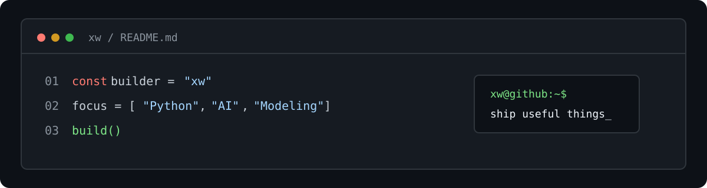
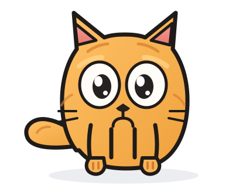

  

# Hi, I'm xw 👋

I'm a Python developer and AI explorer who enjoys turning ideas into practical projects.

- 🔭 Building AI tools, automation workflows, and small products
- 🌱 Learning deep learning, mathematical modeling, and electronic design
- 🧩 Interested in open source, reproducible experiments, and useful developer tools
- 💬 Feedback, issues, and pull requests are always welcome

  

## Tech Stack

  
  
  
  
  
  

## Featured Projects

| Project | What it is | Stack |
| --- | --- | --- |
| [prompt](https://github.com/xw9114/prompt) | Codex CLI prompt experiments and Python tooling | Python |
| [reader](https://github.com/xw9114/reader) | Builds and publishes long-form and short-form reading collections with GitHub Actions | Python |
| [qq-bot](https://github.com/xw9114/qq-bot) | An AI QQ bot based on NoneBot2 and OneBot v11 | Python |
| [skill-pro](https://github.com/xw9114/skill-pro) | A collection of practical AI skills and workflows | Typst |
| [electronic-design](https://github.com/xw9114/electronic-design) | Electronic design code and experiments | Python |
| [blog](https://github.com/xw9114/blog) | Web notes and experiments | HTML |

## GitHub Activity

  
  

---

  Thanks for visiting. Take a look around, open an issue, or share an idea.

